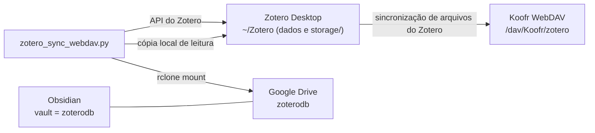

# zotero_sync_webdav

Automação em Python que mantém alinhados três lugares: a biblioteca do Zotero, os arquivos dos anexos e uma pasta de PDFs no Google Drive que também funciona como vault do Obsidian.

## Arquitetura

Há dois canais de arquivos com papéis diferentes. A separação existe de propósito: ela mantém a leitura dos PDFs rápida.



| Canal | Quem usa | Papel |
|---|---|---|
| Koofr WebDAV (`/dav/Koofr/zotero`) | O próprio Zotero, de forma nativa | Entrega o PDF inteiro ao Zotero, sem streaming. É o que deixa a abertura rápida. |
| Google Drive (`zoterodb`) | O script e o Obsidian | Organização por pastas e coleções, notas em Markdown e backup. |

O Zotero não lê o Drive. Quem faz a ponte entre os dois é o script, que lê e grava o `zoterodb` pelo mount do rclone (`~/Google Drive`) e fala com o Zotero pela API e pelo diretório de dados local.

### O que cada parte guarda

- **`~/Zotero`** é o diretório de dados do Zotero Desktop. Em `storage/` ficam as cópias locais dos anexos, uma pasta por anexo. É isso que torna a leitura local e rápida, e também a âncora que o sync usa para comparar conteúdo por hash.
- **Koofr** guarda os anexos no formato do Zotero: um `CHAVE.zip` com o PDF e um `CHAVE.prop` com data e hash.
- **`zoterodb`** guarda os PDFs em pastas que espelham as coleções do Zotero, mais as notas `.md` do Obsidian.

## Vault unificado

A pasta `zoterodb` é ao mesmo tempo o destino físico dos PDFs e o vault do Obsidian. O script trata só arquivos `.pdf` e ignora Markdown e a pasta `.obsidian`.

## Sincronização bidirecional entre pastas e coleções

A identidade de uma coleção é a chave dela no Zotero. O arquivo `.zotero_folders.json`, na raiz do vault, guarda o caminho de cada chave na última execução limpa. Comparando essa memória com o Zotero e com o Drive, cada mudança vira a operação equivalente do outro lado.

| Mudança desde a última execução | O que o sync faz |
|---|---|
| Coleção renomeada ou movida no Zotero | Renomeia a pasta do Drive de uma vez e reaproveita o cache de hash |
| Pasta renomeada no Drive ou no Obsidian | Renomeia a coleção no lugar, mantendo itens e subcoleções |
| Coleção apagada no Zotero | Remove só a pasta vazia, nunca PDFs |
| Pasta apagada no Drive | Apaga só coleção vazia e sem subcoleções |

Salvaguardas: se nenhuma pasta do registro existe, o sync assume drive desmontado e não age; um registro com mais de 14 dias só é renovado; no máximo 10 coleções são apagadas por execução; toda ação fica em `~/.cache/zotero_sync_webdav/duplicate_actions.jsonl`. Com `ZOTERO_FOLDER_SYNC_DRY_RUN=1` o plano só é registrado.

## Segurança dos dados

Duplicatas e arquivos removidos nunca são apagados de imediato. O arquivo vai para uma quarentena local com verificação de hash e expira depois de 30 dias. Itens do Zotero vão para a lixeira do próprio Zotero, que é recuperável pela interface.

## Uso

```bash
python3 zotero_sync_webdav.py                      # sincronização principal
python3 zotero_sync_webdav.py diagnostico          # diagnóstico
python3 zotero_sync_webdav.py duplicatas-relatorio # relatório de duplicatas, só leitura
python3 zotero_sync_webdav.py remove-duplicatas    # simulação; --executar move para a lixeira
python3 zotero_sync_webdav.py setup-autostart      # launcher, timer e watcher systemd
ZOTERO_FOLDER_SYNC_DRY_RUN=1 python3 zotero_sync_webdav.py sync
```

A configuração fica em `~/.config/zotero_sync_webdav/zotero_sync.env`: `ZOTERO_LIBRARY_ID`, `ZOTERO_LIBRARY_TYPE`, `ZOTERO_API_KEY` e `ZOTERO_SYNC_TARGET_FOLDER`. Nunca commite esse arquivo.

## Testes

```bash
python3 -m unittest discover -s tests
```

O GitHub Actions roda a mesma suíte a cada push, em `.github/workflows/tests.yml`.

## Direção planejada: rodar fora do PC

Isto ainda não está implementado. Decisão: o sync **não** vai gravar `.zip` e `.prop` direto no WebDAV do Koofr. Um arquivo fora do padrão faria o Zotero marcar o anexo como corrompido, e o risco não compensa. A importação de PDFs continua exclusiva do Zotero Desktop, pelo recognizer, que é o caminho oficial.

Rodar fora do PC ficou como um modo sem importação, que não está agendado: sincronização de pastas e coleções, renomeações, relatório e limpeza de duplicatas só precisam da API do Zotero e da leitura do Drive, e PDFs novos esperariam na fila até o PC rodar o sync. Um servidor com o Zotero Desktop em headless, por exemplo numa VM Oracle, foi avaliado e **descartado** por não compensar o custo de manter outra máquina. Se um dia o modo sem importação for retomado, o cache de hash e o lock precisariam sair da máquina local.

## Contexto do projeto

A documentação técnica fica em `.context/docs/`, o plano em `.context/docs/planning_gsd/` e as histórias em `.context/prd_ralph/prd.json`.
